# Instinct Datasets

将所有下载的数据集文件放置到当前目录.

Place the downloaded dataset file in the current directory.

## 数据集自动分类

Config WebUI 会扫描本目录顶层的 `.jsonl` / `.jsonl.gz` / `.parquet` 文件，
并按文件名前缀分类：

- `pretrain*.jsonl`：预训练数据，格式为 `{"text": "..."}`。
- `sft*.jsonl`：SFT 数据，格式为 `{"conversations": [...]}`。
- `lora*.jsonl`、`dpo*.jsonl`、`rlaif*.jsonl`、`agent*.jsonl`：对应训练器数据。

将新的指令或 Coding 数据命名为 `sft_<name>.jsonl` 后，它会自动出现在
`full_sft` 的 **Training dataset** 选项中。同一份数据的 `.jsonl` 与
`.parquet` 会同时出现在列表里，选择哪一个都可以；`.report.json` 报告文件
不会被识别为数据集。

## JSONL 编译为 Parquet

`dataset_compiler/` 是一个 Rust 工具，把训练语料编译成 Parquet。编译后的
文件是 `.jsonl` 的直接替代品：训练器、流式预训练、Config WebUI 都直接读取，
无需改动配置。

```bash
cd dataset_compiler && cargo build --release

# 编译（默认整文件预扫描，schema 覆盖每一行）
./target/release/dataset_compiler compile \
  -i ../dataset/pretrain_coder_12b.jsonl \
  -o ../dataset/pretrain_coder_12b.parquet

# 校验行数与取值完全一致
./target/release/dataset_compiler verify \
  ../dataset/pretrain_coder_12b.jsonl ../dataset/pretrain_coder_12b.parquet --rows 2000
```

收益与代价：

- 体积约为 JSONL 的三分之一（zstd），加载时不再需要 Python 逐行解析 JSON。
- 语料自带的 `token_count` 会被保留，因此有界流式（`--dataset_streaming`）
  可以按 token 规划分块而不做任何分词；分块边界对齐 row group，物化一块
  只需重编码这些 row group。
- 代价是一次性的编译步骤：JSONL 更新后需要重新编译（`verify` 用于确认
  编译结果没有丢行、没有改值）。
- 编译输出旁边会生成 `<output>.report.json`，记录源文件摘要、行数、列类型、
  压缩方式、吞吐与告警，便于审计。

Schema 约定（由 `scripts/data_loader/source_format.py` 与各 Dataset 类读取）：
- 预训练：`text` 为字符串，其余标量键（`token_count`、`license`、`source` 等）
  原样保留。
- 对话：`conversations` / `chosen` / `rejected` 为 `list<struct<...>>`，字段
  一律为字符串，字段顺序为 `role`、`content`、`reasoning_content`、`tools`、
  `tool_calls`，之后是语料里出现的其它键（额外字段会被保留，比 JSONL 路径更宽松）。
- 消息之外的嵌套对象（如 `metadata`）存为 JSON 文本；同一键在不同行出现
  互不兼容的类型时也退化为 JSON 文本，并在报告中列为告警，不会丢行。

### 与断点续训的关系

同一语料的 `.jsonl` 与 `.parquet` 被视作同一个数据集：编译后切换到 parquet
继续训练不会被续训校验拒绝（日志会打印 `[Resume] the corpus changed container`）。
分块边界是否一致取决于编译方式：

- **带 `--align-chunk-bytes` 编译**（数值取训练用的 `--streaming_chunk_mb`，例如
  `--align-chunk-bytes 1GiB`）：编译器在 schema 扫描时复现 JSONL 计划的分块规则，
  在每个分块边界处关闭一个 row group，于是「一个 row group = 一个流式分块」。
  两份计划覆盖完全相同的行区间，**游标精确对齐**，日志会打印
  `its chunks are aligned to the JSONL chunk boundaries, so the saved cursor
  points at the same rows`。这是推荐做法。
- **不带该参数**：chunk 边界会被重建，保存的 chunk 游标落在同一相对位置附近，
  最多有一个 chunk 的重放或跳过；日志会给出
  `[Dataset Streaming] resuming on a recompiled corpus: ... row X of Y` 提示。
  偏差随块号增大（每块约 1.2 万行），在 epoch 边界恢复则完全没有偏差。
- **非流式（整库 Arrow）路径**下，两种容器产生完全相同的 packed 数据，续训位置
  一直精确一致。
- 换成**别的**语料（文件名或目录不同）仍会被拒绝，请新建一个训练阶段。

详细参数与实测数据见 `dataset_compiler/README.md`。

## 收集开放许可的 arXiv 论文全文

从 `common-pile/arxiv_papers` 流式收集约 500 MB 的 arXiv 论文。该来源只包含
CC BY、CC BY-SA、CC0 / Public Domain 论文。构建器按全部时间分片均匀取样，
并严格保持“一篇论文一条记录”：不切块、不截断、不改写正文，同时保留 arXiv
ID、URL、作者和许可证元数据。

```bash
python scripts/data_builder/collect_arxiv_pretrain.py

# 例如扩充为约 2 GB
python scripts/data_builder/collect_arxiv_pretrain.py \
  --target-bytes 2000000000 \
  --output dataset/pretrain_arxiv_open_2gb.jsonl \
  --report dataset/pretrain_arxiv_open_2gb.report.json
```

默认输出 `dataset/pretrain_arxiv_open_500mb.jsonl`，可直接被 Config WebUI 识别为
预训练数据。旁边的 `.report.json` 记录来源分片、年份、许可证、SHA-256 和实际
字节数。数据文件保留完整论文，但训练时模型实际看到的长度仍由训练器的
`max_seq_len` 决定。

## 代码专家预训练混合

`dataset/codespecialist.jsonl` 使用按 Instinct tokenizer token 数控制的代码专家配方：约 60%
代码相关数据、20% 中英通用文本、10% 数学推理和 10% 学术摘要。代码部分
包含真实开放仓库代码与 Markdown 文档、竞赛题面/推理/答案、验证通过的 submission、
代码指令、Text-to-SQL 和 Exercism 软件任务。所有来源保持整条记录，不在合成阶段
切块或截断。含 BOS/EOS 超过 4096 tokens 的记录整条丢弃。语料约 16 亿 tokens，
训练两遍约 32 亿 token 呈现量；重复训练不等价于相同数量的新语料。
训练需设置 `max_seq_len=4096` 才能完整利用合格记录；更小长度仍会截断。

真实仓库组件可复现为：

```bash
python scripts/data_builder/collect_stackv2_code_4096.py
python scripts/data_builder/collect_arxiv_abstracts_4096.py
```

完整混合先构建为 `codespecialist_4096.next.jsonl`，校验后再替换正式文件：

```bash
python scripts/data_builder/build_codespecialist_4096.py
```

实际组成、许可证来源、行数、正文比例和 SHA-256 见
`dataset/codespecialist.report.json`。历史清理记录不代表当前文件状态：2026-11-02
本机仍存在 `pretrain_codespecialist.jsonl`，应按历史混合语料单独追溯，不能视作已删除。
原始组件用于支持重建，具体保留情况以文件清单和对应来源报告为准。

## 12B Instinct Coder 预训练语料

面向 V1 MoE 编程模型的最终目标采用 DeepSeek-Coder-V2 的 token 配比：60% 源代码、
10% 数学、30% 自然语言，总计 12B 唯一 tokens。现有 `codespecialist.jsonl` 和
`pretrain_continue.jsonl` 中通过审计的新数据优先复用；不足部分由下列固定 revision
的开放数据补齐：

- 代码：`common-pile/stackv2_edu_filtered`（逐文件开放许可证）；
- 数学：`HuggingFaceTB/finemath` 的 `finemath-4plus`（ODC-By）；
- 英文：`HuggingFaceTB/smollm-corpus` 的 `fineweb-edu-dedup`（ODC-By）；
- 中文：`opencsg/chinese-fineweb-edu`（Apache-2.0 声明，分发前仍需复核上游条款）。

收集器按上游分片原子保存，可以安全中断后重跑：

```bash
python scripts/data_builder/collect_coder_pretrain_12b.py --component all
```

四个补充组件收齐后生成最终全局打乱语料：

```bash
python scripts/data_builder/build_coder_pretrain_12b.py
```

最终构建会按正文 SHA-256 全局精确去重，并用 13-word n-gram 筛除与 HumanEval、
sanitized MBPP test 和 GSM8K test 重叠的记录。所有样本均由项目 tokenizer 验证为
不超过 4096 tokens，不切分、不截断。完整来源、许可证计数、拒绝原因、token 配比
和输出 SHA-256 写入 `dataset/pretrain_coder_12b.report.json`。

`dataset/pretrain_coder_12b.report.json` 记录的成品包含 13,267,273 条完整记录和
11,999,990,666 tokens：代码 7,199,997,236、数学 1,199,996,324、自然语言
3,599,997,106。本机现保留 `pretrain_coder_12b.parquet`；来源 JSONL 的版本和哈希
应同时核对该报告、Parquet 编译报告及后续 24B 合并报告，不能沿用早期文档中的旧哈希。
各类别距名义配额的差值均小于单条 4096-token 上限，这是坚持不切断样本的结果。

## 推荐 SFT 数据准备

在仓库根目录运行：

```bash
# 使用已下载到 dataset/codealpaca/ 的 CodeAlpaca 20K
python scripts/data_builder/prepare_sft_data.py codealpaca-local

# 适合小于 1B 模型的通用指令数据（可先抽样 100K）
python scripts/data_builder/prepare_sft_data.py smol-smoltalk --max-samples 100000

# 执行过滤的 Coding 指令数据
python scripts/data_builder/prepare_sft_data.py bigcode-exec-50k

# 可选 Coding 补充
python scripts/data_builder/prepare_sft_data.py magicoder-75k
```

转换结果统一为 Instinct 所需的 `conversations` 格式，并使用 `sft_` 文件名前缀。

### 混合 Magicoder 110K、MathInstruct 与原始 T2T replay

```bash
python scripts/data_builder/mix_sft_datasets.py
```

默认读取：

- `dataset/magicoder-110k/data-evol_instruct-decontaminated.jsonl`
- `dataset/math-instruct/MathInstruct.json`
- `dataset/sft_t2t.jsonl`

默认输出 `dataset/sft_magicoder110k_mathinstruct_t2t_replay20.jsonl`。其中原始
T2T replay 占最终数据约 20%，使用固定随机种子均匀抽样；最终数据使用磁盘分块
随机混洗，不会把 14 GB 原始 T2T 或完整输出一次性载入内存。可用
`--replay-fraction`、`--seed`、`--chunk-rows` 和 `--output` 调整。

## 在新数据上继续 SFT

在 Config WebUI 选择 `full_sft`，然后将 **SFT start mode** 设为
**Continue a completed SFT on new data**。该模式加载最新或指定的已完成
`full_sft` 普通权重，并为新阶段重新创建 optimizer、scheduler 和训练 step；
它与恢复中断训练的 **Resume an interrupted run** 不同。

Auto sequence buckets 默认将单条上下文限制为 16,384 tokens。SFT 样本超过
上限时会整条丢弃（日志显示 `[Length Filter]` 统计），不会截断出残缺的代码或答案。

## 数据集来源、加工与合并关系

核对日期：**2026-11-02**。以下关系来自本机成品报告、来源清单和构建脚本，
没有重新扫描全部正文验证包含关系，也不表示这些数据当前正在训练。
报告中的来源路径可能是已经编译、归档或移除的中间文件。

- **上游原始数据**：直接下载到项目的数据；上游本身可能已经做过混合、清洗或合成。
- **单源加工数据**：对一个上游做格式转换、筛选、采样、修补或多分片汇总。
- **多源合并数据**：将多个来源或已有成品中的记录按配方选入同一训练文件。
- **本地生成数据**：由项目规则、模板和验证器生成，不属于直接下载的原始语料。
- **来源未完全确认**：已有基础输入，但缺少足够的下载或构建记录，不能直接判定为原生。

同一语料的 JSONL 与 Parquet 只算一个数据集，格式转换不算新增来源。
图中的实线表示“选取或加工后进入”，不保证整个输入均被保留；虚线表示推测或待确认。
只有报告明确记载完整保留时，才能判断输入整体包含于输出。

### 预训练来源关系

| 成品或中间数据 | 分类 | 来源及处理 |
| --- | --- | --- |
| `pretrain_coder_l2l3_24b.parquet` | 成品合并 | 完整合并 `pretrain_coder_12b` 与 L2/L3/通用混合 12B；仅打乱行序，没有再次去重 |
| `pretrain_coder_12b.parquet` | 多源混合 | 从 `codespecialist`、`pretrain_continue` 选入记录，并由 StackV2、FineMath、英文 FineWeb-Edu、中文 FineWeb-Edu 补齐；按 token 约为代码60%、数学10%、自然语言30% |
| `pretrain_coder_12b_seg2_identity_clean.parquet` | 多源混合 | 同类四种上游的新采集分片，经身份审核后混合；报告记录旧训练语料回放为0，是独立第二段，不是第一段的修订版 |
| `pretrain_ultradata_code_l3_cpt_12b_identity_clean.jsonl` | 单源加工汇总 | 来自 `openbmb/UltraData-Code` L3 的多语言分片；清洗、按语言配额选取并打乱 |
| `pretrain_ultradata_l3_cpt_12b_general10_identity_clean.parquet` | 多源混合 | 从纯 L3 成品选取约90% token，加约10%未选用的数学及中英文通用数据 |
| `pretrain_ultradata_l2_30_l3_60_general10_12b_identity_clean.parquet` | 多源混合 | 从上一混合版本选取 L3/通用部分，再加入清洗后的 L2，按 token 约为 L2 30%、L3 60%、通用10% |
| `codespecialist.jsonl` | 多源混合 | 仓库代码、竞赛题解、验证提交、代码指令、SQL、Exercism、通用文本、数学和 arXiv 摘要；使用过旧专家语料中的内容 |
| `pretrain_codespecialist.jsonl` | 历史混合语料 | 文件含来源标签；大小与 `codespecialist.before_4096.report.json` 记录的旧成品一致，疑似旧版改名保留，尚未以全文件哈希确认同一性 |
| `pretrain_continue.jsonl` | 新数据加回放混合 | 新 Python 教育代码、代码 CoT、数学 CoT、Cosmopedia 等，加旧专家语料回放 |
| `pretrain_continue.dedup.jsonl` | 去重派生版 | 从 `pretrain_continue` 排除与 `codespecialist` 重复的内容；不能将去重参照文件算作被合并输入 |
| `pretrain_arxiv_open_500mb.jsonl` | 单源加工 | 从 `common-pile/arxiv_papers` 收集完整论文 |
| `pretrain_arxiv_abstracts_160m_tokens_4096.jsonl` | 单源加工 | 从 `common-pile/arxiv_abstracts` 筛选完整摘要；不是上一全文文件的缩小版 |

图中省略扩展名；通用补充节点合并显示 FineMath、英文 FineWeb-Edu 和中文 FineWeb-Edu。

```mermaid
flowchart TB
    subgraph UPSTREAM["上游来源与已有基础输入"]
        STACK["StackV2 代码"]
        GENERAL["FineMath / 英文 FineWeb-Edu / 中文 FineWeb-Edu"]
        ULTRA["UltraData-Code"]
        COMPONENTS["竞赛题解 / 验证提交 / 指令 / SQL / Exercism / 数学"]
        ARXIV["arXiv 全文与摘要"]
        T2T["pretrain_t2t 系列：来源未完全确认"]
        OLD["pretrain_codespecialist：历史混合语料"]
        OLDVERSION["旧 codespecialist：before_4096 报告"]
        NEW["新增 Python / 代码 CoT / 数学 CoT / Cosmopedia"]
    end
    subgraph BUILD["加工与合并成品"]
        CS["codespecialist"]
        CONT["pretrain_continue"]
        DEDUP["pretrain_continue.dedup"]
        C12["pretrain_coder_12b：12B"]
        SEG2["pretrain_coder_12b_seg2_identity_clean：独立第二段"]
        L3["pretrain_ultradata_code_l3_cpt_12b_identity_clean：纯 L3"]
        L3G["pretrain_ultradata_l3_cpt_12b_general10_identity_clean：L3 90% / 通用10%"]
        L2["UltraData L2 清洗池"]
        MIX12["pretrain_ultradata_l2_30_l3_60_general10_12b_identity_clean：L2 30% / L3 60% / 通用10%"]
        FINAL["pretrain_coder_l2l3_24b：24B"]
        ARXIVOUT["pretrain_arxiv_open_500mb / pretrain_arxiv_abstracts_160m_tokens_4096"]
    end
    OLDVERSION -.->|"疑似改名，待哈希确认"| OLD
    OLD -->|"复用部分内容"| CS
    STACK --> CS
    COMPONENTS --> CS
    T2T --> CS
    ARXIV -->|"摘要等学术组件"| CS
    OLD -->|"旧语料回放"| CONT
    NEW --> CONT
    CONT -->|"排除与 codespecialist 重复的记录"| DEDUP
    CS --> C12
    CONT --> C12
    STACK --> C12
    GENERAL --> C12
    STACK -->|"新采集分片"| SEG2
    GENERAL -->|"新采集分片"| SEG2
    ULTRA -->|"L3 分片"| L3
    L3 -->|"选取部分"| L3G
    GENERAL -->|"未选用的新记录"| L3G
    ULTRA -->|"L2 分片"| L2
    L3G -->|"选取 L3 与通用部分"| MIX12
    L2 --> MIX12
    C12 -->|"完整输入"| FINAL
    MIX12 -->|"完整输入"| FINAL
    ARXIV --> ARXIVOUT
    classDef raw fill:#e8f5e9,stroke:#388e3c,color:#173a1a
    classDef mixed fill:#e3f2fd,stroke:#1976d2,color:#123859
    classDef derived fill:#fff3e0,stroke:#ef6c00,color:#603000
    classDef unknown fill:#f3e5f5,stroke:#8e24aa,color:#492052
    class STACK,GENERAL,ULTRA,COMPONENTS,ARXIV raw
    class CS,OLD,CONT,C12,SEG2,L3G,MIX12,FINAL mixed
    class DEDUP,L3,L2,ARXIVOUT derived
    class T2T,OLDVERSION unknown
```



24B 报告记录 22,187,244 行、23,999,989,035 tokens，合并时未丢行或改写。
这只证明两份直接输入被完整保留，不能推导出它们的所有上游原始分片也被完整保留。
验证记录包含全量 token_count 检查和10,000行取值抽查，不能称为全量逐值比对。
本节没有重新执行这些历史验证。

核对入口：`pretrain_coder_l2l3_24b.report.json`、`pretrain_coder_l2l3_24b.verification.json`、
`pretrain_coder_12b.report.json`、`pretrain_coder_12b_seg2_identity_clean.report.json`、
三个 `pretrain_ultradata_*.report.json`、`codespecialist.report.json`、
`pretrain_continue.report.json` 和 `pretrain_continue.dedup.report.json`。
这些本机报告默认不入库；重建时还需对应版本、来源文件与构建脚本。

### SFT 合并与修订关系

| 文件或目录 | 分类及来源 |
| --- | --- |
| `sft_magicoder110k_mathinstruct_ultrachat200k.jsonl` | Magicoder 110K + MathInstruct + UltraChat；构建器为 `scripts/data_builder/mix_magicoder_math_ultrachat.py` |
| `sft_magicoder110k_mathinstruct_ultrachat20.jsonl` | 同类三源配比版本；缺少独立成品报告，具体选取比例应由运行参数或记录复核 |
| `sft_competitive_t2t_ultrachat_16k_cot50plus.jsonl` | 竞赛 CoT + T2T CoT + UltraChat；不要把脚本用于查重的所有输入都当作选入来源 |
| `sft_competitive_t2t_ultrachat_16k_coding_heavy.jsonl` | 在 `cot50plus` 成品基础上增加竞赛记录 |
| `sft_easy_medium_competitive_clean_4k.jsonl` | 竞赛 + UltraChat + MathInstruct + Magicoder + CodeAlpaca + T2T |
| `quality_python_sft/` | 包含单源精选文件和多个混合版本；初版包含 KodCode/BigCode/回放等，审核版 `continue_sft_reviewed_train.jsonl` 使用 KodCode + GSM8K train + 清理后 T2T 回放，已移出 BigCode |
| `sft_continue.jsonl` | 审核版 Python SFT + 指令理解 + 验证 CoT + T2T 回放，详细行数与来源见 `sft_continue.README.md` 和 `sft_continue.audit.json` |
| `sft_v1moe_balanced_64k_identity_clean.jsonl` | T2T、审核版 Python、Magicoder、短指令、UltraChat、LongAlign、身份锚点及合成多轮混合 |
| `reasoning_sft_v2/` | GSM8K train + 规则生成数据 + KodCode + 旧 SFT 回放 + 少量 Orca-Math |
| `sft_codealpaca_20k.jsonl` | CodeAlpaca 单源格式转换 |
| `sft_competitive_beginner_4096.jsonl` | 竞赛来源的单源筛选加工 |
| `instruction_understanding_sft/`、`verified_cot_sft/`、`reasoning_sft_strict/` | 项目内规则生成与验证的数据；pilot 通常是 train 子集，不应重复混入 |
| `identity_anchors_instinct.jsonl` | 本地生成的身份锚点 |
| `humaneval_oj/` | 基于评测题构建的 OJ 派生数据，不能作为普通新增训练语料混入 |

```mermaid
flowchart TB
    MAGIC["Magicoder"] --> MMU["Magicoder + MathInstruct + UltraChat 混合系列"]
    MATH["MathInstruct"] --> MMU
    CHAT["UltraChat"] --> MMU
    COMP["竞赛数据"] --> COT["sft_competitive_t2t_ultrachat_16k_cot50plus"]
    MINI["sft_t2t_mini"] --> COT
    CHAT --> COT
    COT --> HEAVY["sft_competitive_t2t_ultrachat_16k_coding_heavy"]
    COMP -->|"追加记录"| HEAVY
    COMP --> EASY["sft_easy_medium_competitive_clean_4k"]
    MAGIC --> EASY
    MATH --> EASY
    CHAT --> EASY
    MINI --> EASY
    ALPACA["CodeAlpaca"] --> EASY
    KOD["KodCode"] --> REVIEWED["quality_python_sft/continue_sft_reviewed_train"]
    GSM["GSM8K 官方 train"] --> REVIEWED
    MINI -->|"清理后回放"| REVIEWED
    REVIEWED --> SCONT["sft_continue"]
    INST["本地生成：instruction_understanding_sft"] --> SCONT
    VCOT["本地生成：verified_cot_sft"] --> SCONT
    MINI -->|"另选审核后回放"| SCONT
    MINI --> S64["sft_v1moe_balanced_64k_identity_clean"]
    REVIEWED --> S64
    MAGIC --> S64
    CHAT --> S64
    INST -->|"短指令"| S64
    LONG["LongAlign"] --> S64
    SYN["本地生成：身份锚点 / 多轮"] --> S64
    subgraph VERSIONS["同一 mini 数据的修订分支"]
        CLEAN["sft_t2t_mini.identity_clean：删除污染记录"]
        REPAIR1["sft_t2t_mini.identity_repaired"]
        REPAIR2["sft_t2t_mini.identity_repaired_v2"]
        READY["sft_t2t_mini.train_ready"]
        REPAIR1 --> REPAIR2 --> READY
    end
    MINI --> CLEAN
    MINI --> REPAIR1
```



`identity_clean` 与 `identity_repaired` 是从原始 mini 出发的两个分支；
修补分支再经过 v2 修补和过滤得到 `train_ready`。它们高度重叠，不能作为独立新语料直接拼接。
依据为 `review_candidates/sft_t2t_mini.identity_*.report.json` 和
`sft_t2t_mini.train_ready.jsonl.report.json`。
其他 SFT 关系可核对成品同名报告、`quality_python_sft/README.md`、
`v1moe_sft64k/build.report.json` 及 `scripts/data_builder/` 下对应构建器。
`v1moe_final/` 目前保留候选和审核材料；存在名为 final 的目录或构建脚本，不足以证明成品已完成。

### 原始目录、缓存与未确认来源

Magicoder、MathInstruct、NuminaMath、UltraChat、BigCode、CodeAlpaca 等下载文件，
以及 `competitive-coding/data/`、`code_contests/_hf_parquet/`、`taco/_hf_raw/`
中的上游分片，属于原始来源。`gsm8k/test.jsonl` 与
`humaneval/HumanEval.jsonl.gz` 是评测来源，应与训练输入区分。
`first_sft_sources/` 保存 CommitPackFT、Code-Feedback 下载材料；
`v1moe_final_sources/` 保存 OpenCodeInstruct、ChatQA2 下载材料。

`coder_pretrain_12b/`、`coder_pretrain_12b_seg2_novel_raw/`、
`ultradata_code_l3_12b/` 等工作目录同时容纳原始下载、筛选分片和索引；
`coder_pretrain_12b_seg2_review/`、`cpt_unused_general_v1/`、`cpt_l2_l3_12b_v1/`
主要是审核或混合工作区。不能把整个目录一概标成原生或废弃，也不能把目录下所有文件重复纳入合并。
`*.sources.jsonl`、provenance、审核记录和排除索引是追溯材料，不是独立训练来源。

`pretrain_t2t*`、基础 `sft_t2t*`、`dpo.jsonl`、`rlaif.jsonl`、`agent_rl*.jsonl`、
`lora_*.jsonl` 及 `raw_coder/raw_dataset.csv` 的原始构建链尚未完全确认。
不能仅凭命名认定它们是单源原生，或认定 mini 是大文件的严格子集。
来源图用于说明构建关系，不是删除清单；实际归档还需核对训练配置、续训依赖、
来源版本、记录保留情况与完整性。
